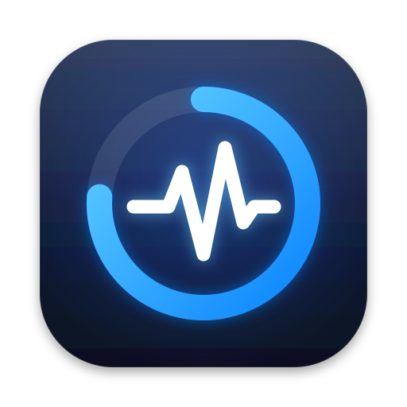

<p align="center"></p>

# Pulse

Monitor any job from your Mac's menubar: training runs, builds, deploys, data pipelines, cron jobs.
Progress bars, live metric charts, notifications when something finishes, fails or goes quiet, and
buttons to stop it or act on it.

```bash
pulse run -- python train.py            # no code changes: progress and metrics are read from the output
pulse push deploy status=running progress=2/5
pulse watch ingest --cmd 'aws s3 cp s3://bucket/progress.json -'
```

- **Zero setup.** `pulse run` reads tqdm bars, `epoch 3/10`, `loss=0.43`, JSON lines and Hugging Face
  Trainer logs. Jobs appear on first report; charts, alerts and ETAs are inferred. It also records
  what the job uses: CPU and memory, GPU (NVIDIA or Apple Silicon) and free disk.
- **Menubar first.** A progress ring in the menubar, a popover with every running job, a page per run
  with live charts, run comparison and the log tail.
- **Notifications that matter.** Finished, failed, lost, stuck, NaN, disk almost full, plus your own rules
  (`val_loss new min`, `eta < 5m`, `no update for 15m`). Stop, mute or answer right from the notification.
- **Two-way.** Stop a job from the menubar; send it commands; let it ask you a question and wait
  (`pulse.ask("Deploy?", ["approve", "reject"])`).
- **Remote jobs.** A VM or CI runner reports over Tailscale with a token that can only report its own job.
- **Private.** Everything stays on your Mac. No accounts, no telemetry.

## Install

Download **Pulse-&lt;version&gt;.dmg** from [Releases](../../releases), open it and drag Pulse to
Applications (macOS 13+, Apple Silicon or Intel). Pulse lives in the menubar. Then put the CLI on
your PATH; it ships inside the app:

```bash
sudo mkdir -p /usr/local/bin && sudo ln -sf /Applications/Pulse.app/Contents/MacOS/pulse /usr/local/bin/pulse
pulse doctor
```

If a release isn't notarized yet, open it the first time with right-click → **Open**.
Linux machines that report to a Mac use the `pulse_<version>_linux_<arch>.tar.gz` archives.

### From source

Requirements: Go 1.26+, Node 20+ with pnpm (to build the UI).

```bash
./scripts/build-app.sh          # build/Pulse.app and build/pulse (ARCHS="arm64 amd64" for universal)
./scripts/make-dmg.sh           # build/Pulse-<version>.dmg
open build/Pulse.app
```

The `pulse` CLI is a static Go binary and also runs on Linux: `GOOS=linux go build ./cmd/pulse`.

Python helper (optional): `pip install ./sdk/python`, see [sdk/python](sdk/python/README.md).

Coding agents (Claude Code, Codex, …): `pulse skill install` installs [skills/pulse/SKILL.md](skills/pulse/SKILL.md),
which teaches an agent to report the jobs it starts through Pulse. `pulse skill` prints it for other agents.

## Use

| Goal | Command |
|---|---|
| Monitor a command | `pulse run -- <command>` |
| Report from a script | `pulse push <job> key=value …` |
| Poll something that can't report | `pulse watch <job> --cmd/--url/--file …` |
| See jobs | `pulse ls`, `pulse show <job>`, `pulse open <job>` |
| Alerts | `pulse alert <job> '<rule>'` |
| Stop | `pulse stop <job>` |
| Per-project settings | `pulse.yaml` next to your code (see [docs/config.md](docs/config.md)) |
| Report from another machine | `pulse remote enable`, `pulse remote token <job>` |

Every command has `--help`; read commands take `--json`.

## Docs

- [CLI reference](docs/cli.md)
- [pulse.yaml reference](docs/config.md)
- [HTTP API](docs/api.md)
- [Security model](docs/security.md)
- [Releasing](docs/release.md)
- [Design plan](PLAN.md)

## Develop

```bash
go test ./...                                   # unit and integration tests
(cd web && pnpm install && pnpm run build)      # UI (embedded into the app)
python3 -m unittest discover -s sdk/python/tests
test/e2e/run.sh                                 # end to end against a headless app
```
